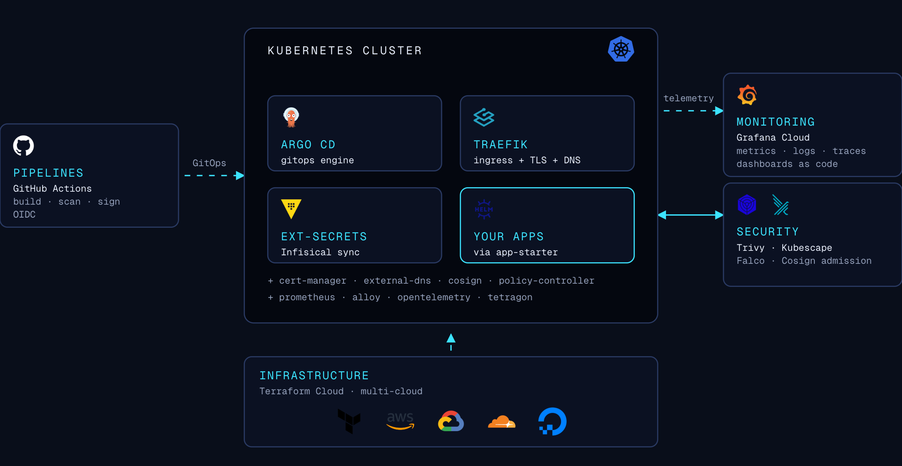

# SynKube

> **Secure multi-cloud Kubernetes platforms and agentic delivery — production-ready in hours, not weeks.**

Synkube is an infrastructure and DevOps automation company focused on cloud-native solutions. We build production-tested applications, platform starter kits, and deployment pipelines.

[](https://synkube.com)

**[synkube.com](https://synkube.com)** — Multi-cloud Kubernetes with Terraform, GitOps, shift-left CI, and runtime security.
**[synkube.com/agents](https://synkube.com/agents)** — Hermes agents for delivery automation (context, skills, ephemeral GitHub and cloud access).

---

## Open source

### [charts](https://github.com/synkube/charts) [](https://artifacthub.io/packages/search?repo=synkube)

| Chart | Description |
| --- | --- |
| **[app-full](https://artifacthub.io/packages/helm/synkube/app-full)** | Complete application chart bundling workloads, namespace resources, and cluster resources |
| **[app-starter](https://artifacthub.io/packages/helm/synkube/app-starter)** | Universal chart for most K8s workloads (Deployments, StatefulSets, Jobs, CronJobs) |
| **[app-extensions](https://artifacthub.io/packages/helm/synkube/app-extensions)** | Namespace-scoped resources (Secrets, ConfigMaps, RBAC, NetworkPolicies) |
| **[platform-extensions](https://artifacthub.io/packages/helm/synkube/platform-extensions)** | Cluster-scoped resources (ClusterRoles, ClusterSecretStores, Certificates) |

```bash
helm install myapp oci://ghcr.io/synkube/charts/app-starter --version 1.1.0 -f values.yaml
# or: helm repo add synkube https://synkube.github.io/charts
```

### [actions](https://github.com/synkube/actions)

Reusable GitHub Actions and workflows: GitOps deploy, Docker build/push to GHCR, Trivy/KICS scans, ArgoCD diff preview, GitHub OIDC.

---

## Platform (private repos)

### Synkube Lite

GitOps platform on Kubernetes with Argo CD.

| Repository | Purpose |
| --- | --- |
| [lite-infra](https://github.com/synkube/lite-infra) | Cluster and bootstrap Terraform (TFC) |
| [lite-argo-apps](https://github.com/synkube/lite-argo-apps) | Argo CD app-of-apps and live values |

**Stack:** Argo CD • External Secrets (Infisical) • cert-manager • Traefik • Grafana Cloud • shift-left security (Cosign, Falco, Kubescape)

### ent-aws — AWS enterprise

Multi-account landing zone and EKS workload platform.

| Repository | Purpose |
| --- | --- |
| [ent-aws-org-infra](https://github.com/synkube/ent-aws-org-infra) | Organizations, SCPs, SSO, bootstrap |
| [ent-aws-shared-infra](https://github.com/synkube/ent-aws-shared-infra) | Hub, log archive, security audit, tooling |
| [ent-aws-account-infra](https://github.com/synkube/ent-aws-account-infra) | Workload account baseline |
| [ent-aws-apps-infra](https://github.com/synkube/ent-aws-apps-infra) | VPC, EKS, platform data |
| [ent-aws-sam-apps](https://github.com/synkube/ent-aws-sam-apps) | SAM serverless apps monorepo |

### ent-cf — Cloudflare

| Repository | Purpose |
| --- | --- |
| [ent-cf-infra](https://github.com/synkube/ent-cf-infra) | Zones, platform data, Zero Trust (TFC) |
| [ent-cf-apps](https://github.com/synkube/ent-cf-apps) | Workers and Pages (Wrangler, pnpm) |

### Shared platform

| Repository | Purpose |
| --- | --- |
| [platform-infra](https://github.com/synkube/platform-infra) | External SaaS Terraform (TFC workspaces) |
| [terraform-modules](https://github.com/synkube/terraform-modules) | Private Terraform child modules |
| [template-infra](https://github.com/synkube/template-infra) | Infra repo template (workspaces, Makefile, CI) |

---

## Applications (private repos)

| Repository | Purpose |
| --- | --- |
| [apps-go](https://github.com/synkube/apps-go) | Go services monorepo |
| [apps-web](https://github.com/synkube/apps-web) | Web monorepo (Turborepo, pnpm, Next.js) |
| [apps-python](https://github.com/synkube/apps-python) | Python services monorepo |

---

## Technology stack

| Category | Technologies |
| --- | --- |
| **IaC** | Terraform, Terraform Cloud |
| **Cloud** | AWS, GCP, DigitalOcean, Cloudflare, Vercel |
| **Orchestration** | Kubernetes (DOKS, EKS, GKE, k3s) |
| **GitOps** | Argo CD, Helm, GHCR |
| **CI/CD** | GitHub Actions ([synkube/actions](https://github.com/synkube/actions)) |
| **Secrets** | External Secrets Operator, Infisical |
| **Security** | OIDC, Cosign/Sigstore, Trivy, KICS, Falco |
| **Observability** | OpenTelemetry, Prometheus, Grafana Cloud |
| **Languages** | Go, TypeScript, Python, Node.js |

---

*Infrastructure, GitOps, and agentic delivery for cloud-native teams.*
